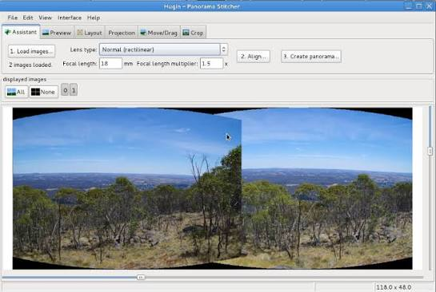
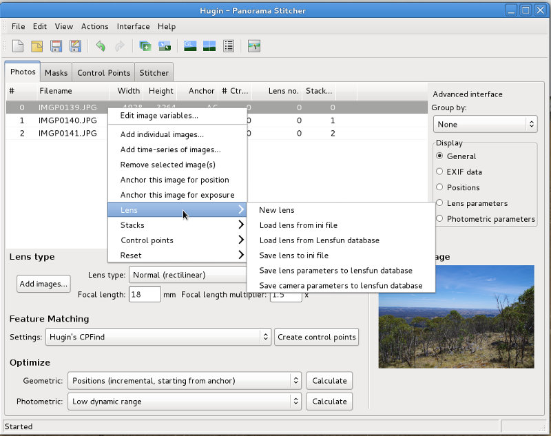
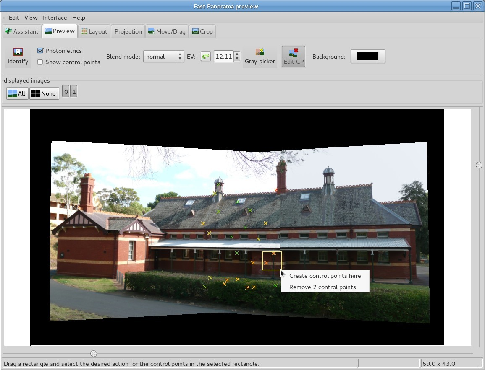

# Hugin for Turning Overlapping Photos into Panoramas

A mountain ridge may fit across six photographs while the foreground refuses to line up. Hugin Panorama lets you work on image alignment, projection and blending as separate decisions, with an editable project behind the final image.

[](https://hugin-panorama.github.io/Hugin-Panorama-Stitcher/)

## Choose the shape of the finished view

The output projection changes how a wide scene fits onto a flat image.
It is separate from the lens type assigned to the source photographs.
Start with the intended presentation, then inspect important lines near the edges.

| Intended result | Projection to consider |
| --- | --- |
| A modest field of view with straight architectural lines | Rectilinear |
| A broad horizontal sweep for a print | Cylindrical |
| A full spherical scene for a compatible viewer | Equirectangular |
| A deliberately curved, expansive composition | Stereographic |

The [projection controls](https://hugin.sourceforge.io/docs/manual/Hugin_Projection_tab.html) adjust output projection and field of view.
The [Stitcher reference](https://hugin.sourceforge.io/docs/manual/Hugin_Stitcher_tab.html) describes projection limits and output choices.
For hugin 360 work, the photographs must cover the scene you intend to show; selecting a spherical projection cannot supply missing coverage.



A comparable remapping stage can be inspected in OpenStitching's [warper.py](stitching/warper.py).
Its list of supported warp types provides a useful code-level comparison with projection choices.

## Correct the geometry before hiding a seam

Load one coherent sequence through the Assistant and verify the source lens information.
Run alignment, then inspect overlaps containing buildings, branches or other distinct detail.
The [Assistant guide](https://hugin.sourceforge.io/docs/manual/Hugin_Assistant_tab.html) explains the automated alignment step.

1. Choose an overlapping image pair with a visible mismatch.
2. Inspect control points on features that represent the same physical location.
3. Remove incorrect correspondences and add well-distributed replacements where needed.
4. Re-run geometric optimization and inspect the result again.
5. Check several overlaps rather than judging only the center of the panorama.

The [control point guide](https://hugin.sourceforge.io/docs/manual/Hugin_Control_Points_tab.html) explains point placement and fine tuning.
Movement between shots and nearby objects can make a single clean alignment difficult.
Avoid using a moving subject as the main evidence for how two photographs connect.

The OpenStitching matching sequence is represented by [feature_detector.py](stitching/feature_detector.py) and [feature_matcher.py](stitching/feature_matcher.py).
Camera estimation and refinement are separated in [camera_estimator.py](stitching/camera_estimator.py) and [camera_adjuster.py](stitching/camera_adjuster.py).
[camera_wave_corrector.py](stitching/camera_wave_corrector.py) handles wave correction, while [subsetter.py](stitching/subsetter.py) selects a connected image subset.

## Keep a project that can be rendered again

Save the PTO project together with a stable arrangement of its source images.
A project records processing decisions; it does not replace the photographs.
Use unique source filenames and keep a copy before applying automated changes.

With Hugin's command-line tools installed, create a project and run its Assistant:

```bash
pto_gen -o ridge.pto ridge-left.jpg ridge-center.jpg ridge-right.jpg
hugin_executor --assistant ridge.pto
```

The Assistant updates the project file in place.
Open the result in Hugin Panorama Stitcher to review the geometry, crop and output settings.
See [pto_gen](https://hugin.sourceforge.io/docs/manual/Pto_gen.html) and [hugin_executor](https://hugin.sourceforge.io/docs/manual/Hugin_executor.html) for the supported syntax.

After reviewing and saving the project, render it with a distinct output prefix:

```bash
hugin_executor --stitching --prefix=ridge-final ridge.pto
```

The project settings determine the requested outputs and required helper programs.
Rendering an existing project lets you revisit output choices without rebuilding every alignment decision.

## Decide what exposure processing should accomplish

Exposure correction, exposure fusion and HDR output address different goals.
Use the [Exposure controls](https://hugin.sourceforge.io/docs/manual/Hugin_Exposure_tab.html) to review brightness, white balance and vignetting parameters.
For bracketed captures, check stack assignments and exposure values before choosing a fusion or HDR output.

- Inspect a bright overlap and a dark overlap after photometric adjustment.
- Keep enough source coverage to replace an unwanted moving subject.
- Use inclusion or exclusion masks when you need to guide the blender.
- Review the actual stitched image before accepting a difficult seam.

The [mask guide](https://hugin.sourceforge.io/docs/manual/Hugin_Mask_tab.html) explains how masks influence blending.
A mask that excludes the only available view of an area can leave a hole.



For an OpenStitching comparison, [exposure_error_compensator.py](stitching/exposure_error_compensator.py) covers exposure compensation.
[seam_finder.py](stitching/seam_finder.py) chooses seams, and [blender.py](stitching/blender.py) combines the contributing images.
These separate stages help explain why a brightness change and a misplaced edge need different adjustments.

## Inspect the crop at the intended output size

Fast Preview is useful for composition, but it does not show the final seam blending.
Its reduced input resolution also makes it unsuitable for judging every fine detail.
The [Fast Preview documentation](https://hugin.sourceforge.io/docs/manual/Hugin_Fast_Preview_window.html) describes these differences.

Use the [Crop tab](https://hugin.sourceforge.io/docs/manual/Hugin_Crop_tab.html) to remove empty edges from the output panorama.
Check the corners after changing projection or straightening the horizon.
Inspect the final render for doubled edges, abrupt brightness changes and subjects cut by seams.



OpenStitching handles image inputs in [images.py](stitching/images.py), scaling in [megapix_scaler.py](stitching/megapix_scaler.py), and cropping in [cropper.py](stitching/cropper.py).
The corresponding input and scaling checks appear in [test_images.py](tests/test_images.py) and [test_megapix_scaler.py](tests/test_megapix_scaler.py).
A smaller preview and a full-resolution export should be compared as different stages of the same job.

## Compare the automatic pipeline on a small image set

A hugin photo stitcher workflow benefits from understanding which processing stage produced a defect.
An independent OpenStitching run can provide a second result to inspect on the same overlapping images.
For an environment with the Python package and OpenCV installed, this example uses a named detector:

```python
import cv2
from stitching import Stitcher
stitcher = Stitcher(detector="sift")
panorama = stitcher.stitch([
    "ridge-left.jpg", "ridge-center.jpg", "ridge-right.jpg"
])
if not cv2.imwrite("ridge-comparison.jpg", panorama):
    raise OSError("Could not save the comparison panorama")
```

Compare geometry and seam behavior rather than expecting pixel-identical output.
[stitcher.py](stitching/stitcher.py) coordinates the stages, and [verbose.py](stitching/verbose.py) exposes intermediate processing results.
[stitch.py](stitching/cli/stitch.py) implements the package's command interface.
[test_stitcher.py](tests/test_stitcher.py) and [test_stitch_cli.py](tests/test_stitch_cli.py) exercise end-to-end and CLI behavior.
[test_detector.py](tests/test_detector.py) and [test_matcher.py](tests/test_matcher.py) cover feature detection and matching.

Keep a small representative set for comparing changes before committing to a much larger render.
Include difficult overlap regions, not just an easy pair of distant photographs.
Record the input selection and settings so that the comparison can be repeated.

## Related Search Terms

Hugin Panorama, Hugin Panorama Stitcher, hugin photo stitcher, hugin software, hugin 360, panorama, panorama-stitching, image-stitching, photography, image-processing, computer-vision, opencv, python, exposure-fusion, hugin
